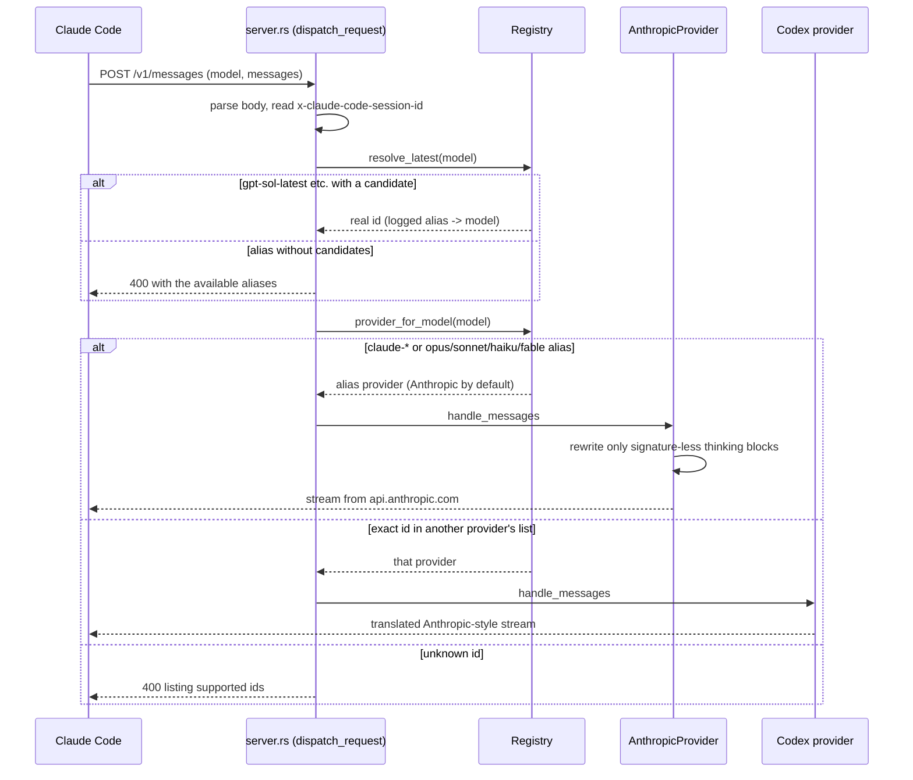
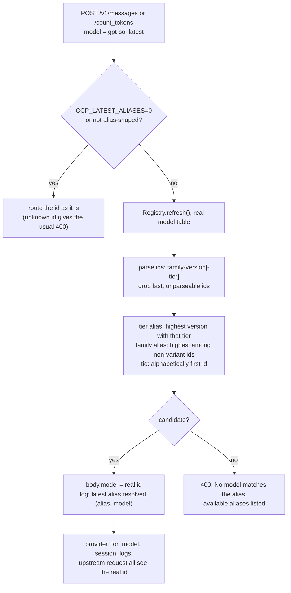
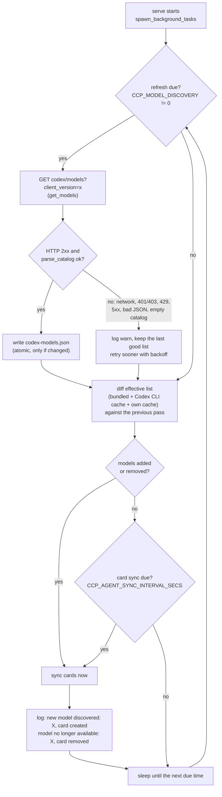
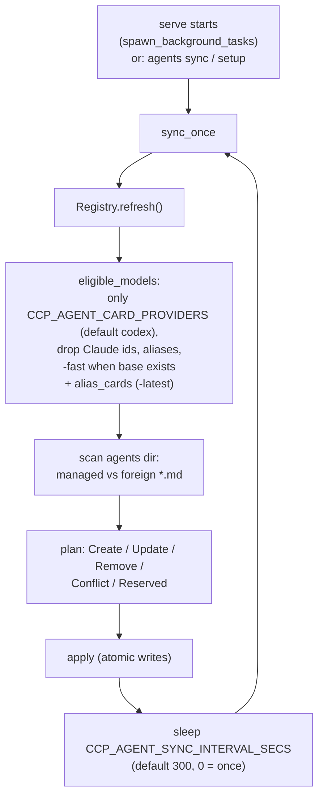
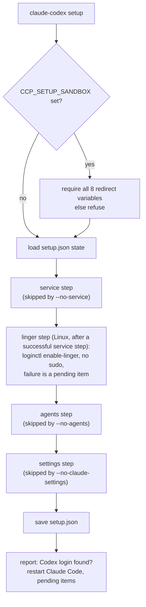
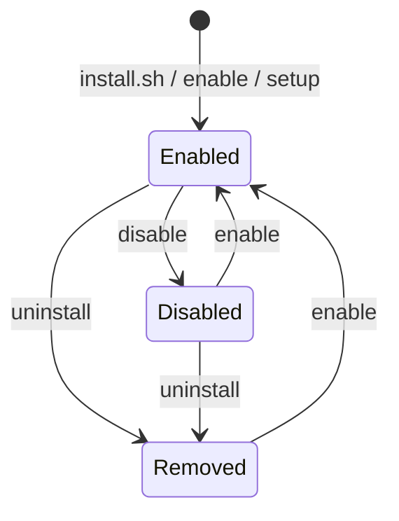
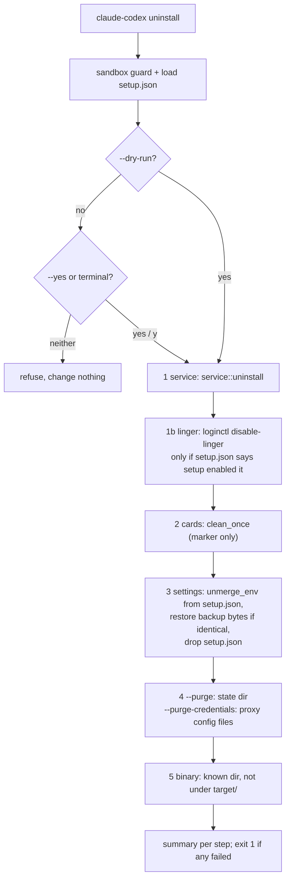

# Architecture

This file describes the present state of the code. It is rewritten, not appended to; history lives in [CHANGELOG.md](CHANGELOG.md) and [CHANGELOG_AI.md](CHANGELOG_AI.md). Contributor workflow is in [docs/development.md](docs/development.md).

`claude-codex` is a local HTTP proxy. Claude Code speaks the Anthropic Messages API to it; the proxy picks a backend from the request's model name and either forwards the request unchanged (Claude) or translates it (everything else).

## Where the code comes from

| Layer | Origin | Where |
|---|---|---|
| Server, registry, Codex translator, monitor TUI | [raine/claude-code-proxy](https://github.com/raine/claude-code-proxy) | `src/server.rs`, `src/registry.rs`, `src/providers/codex`, `src/tui.rs`, `src/monitor*` |
| Anthropic passthrough, reasoning portability, Codex CLI credentials, Codex catalog from `models_cache.json` | [fcakyon/claude-code-with-codex](https://github.com/fcakyon/claude-code-with-codex) | `src/providers/anthropic`, `src/providers/translate_shared.rs`, `src/providers/codex/auth`, `src/providers/codex/translate/model_allowlist.rs` |
| Autostart service, `setup`/`enable`/`disable`/`status`, agent cards, `-latest` aliases, live model refresh, own model discovery | this fork (josefl03/claude-codex) | `src/service.rs`, `src/linger.rs`, `src/setup.rs`, `src/lifecycle.rs`, `src/latest.rs`, `src/agent_cards.rs`, `src/model_discovery.rs`, `Registry::refresh`, mtime cache in `model_allowlist.rs`, `get_models` in `providers/codex/client.rs`, `scripts/install.sh` |

## Modules

| Module | Responsibility |
|---|---|
| `src/main.rs` | CLI (clap). Subcommands: `serve`, `monitor`, `models`, `agents`, `service`, `setup`, `enable`, `disable`, `status`, `uninstall`, `codex auth`, `version`, hidden `demo`. `serve` starts the HTTP server and the model-discovery and agent-card background loop. `models --refresh` forces a discovery; `models` also prints the `-latest` alias table |
| `src/server.rs` | axum router: `/v1/messages`, `/v1/messages/count_tokens`, `/v1/models`, `/healthz`, `/monitor`; optional `/v1/responses`, `/v1/chat/completions`, images and transcriptions behind config flags. Selects a provider per request |
| `src/registry.rs` | Model table per provider, `provider_for_model`, `refresh`, alias handling, `latest_aliases` and `resolve_latest` (feed `src/latest.rs` with the real model table) |
| `src/latest.rs` | Pure, deterministic `<family>-latest` / `<family>-<tier>-latest` algorithm: id parsing, version order, variant exclusion, tie-break, `CCP_LATEST_ALIASES` |
| `src/provider.rs` | `Provider` trait (`handle_messages`, `handle_count_tokens`, `supported_models`, `cli`) |
| `src/providers/anthropic` | Passthrough to Anthropic. No credentials of its own |
| `src/providers/codex` | Anthropic to OpenAI Responses translation, Codex auth from the Codex CLI file |
| `src/providers/translate_shared.rs` | Shared types and the reasoning-tag helpers (`wrap_reasoning`) |
| `src/config.rs`, `src/paths.rs` | Environment and `config.json` resolution; config and state directories |
| `src/model_discovery.rs` | Own discovery of the Codex model catalog, the proxy's `codex-models.json` cache, and the background loop that refreshes models and then syncs cards |
| `src/agent_cards.rs` | Generation, diffing and sync of subagent cards, including one card per `-latest` alias; the background sync is skipped while the `disabled` marker exists |
| `src/service.rs` | systemd user unit and LaunchAgent management: `install` (write, enable, start), `disable` (stop and disable, keep the file), `uninstall`, `status`, `restart`, and the read-only `inspect` used by `status` |
| `src/lifecycle.rs` | `enable` (an alias of the setup logic that also clears the `disabled` marker), `disable` (marker, settings revert, cards, service, record) and `status` (pure `render_status` over a gathered `StatusReport`) |
| `src/setup.rs` | One-shot setup and its undo; `same_base_url` treats `localhost`, `127.0.0.1` and `[::1]` with the same effective port as one address |
| `src/uninstall.rs` | `claude-codex uninstall`: tolerant sequence of independent steps (service, cards, `settings.json` revert from `setup.json`, optional purge of state and of the proxy's own credentials, binary), each reported with a check mark or a cross |
| `src/monitor.rs`, `src/tui.rs`, `src/traffic.rs`, `src/logging.rs` | Dashboard, optional traffic capture, logging |

## Request flow

`dispatch_request` strips a trailing `[1m]`, resolves a `-latest` alias to its real id (see [Latest aliases](#latest-aliases)), then `provider_for_model`: Claude-shaped ids and the aliases go to the configured alias provider (`CCP_ALIAS_PROVIDER`, default Anthropic); any other id must match a provider's model list exactly. If it does not, the registry refreshes once (a model may have appeared in the Codex catalog) and tries again. Session affinity is deliberately ignored, so a Codex request never drags the Opus slot off Anthropic.

## Model registry and refresh

The effective Codex model list is the union of three sources (`allowed_models()` in `model_allowlist.rs`), each model also exposed with a `-fast` suffix:

1. the bundled list (`BUNDLED_MODELS`);
2. the listed, API-capable slugs in the Codex CLI's `models_cache.json` (next to `auth.json`), read only;
3. the same kind of slugs in the proxy's own `codex-models.json` in its state directory, written by `model_discovery`.

Files 2 and 3 are parsed through an mtime-and-size-keyed cache, and a file that is unreadable or half-written keeps the last good parse instead of emptying the list. `Registry::refresh` rebuilds the Codex entry from the union; it runs on every `all_supported_models`, `grouped_models` and on an unknown-model miss, so a model that just arrived is routable without a restart. Registries built with `from_providers` (tests) are not dynamic and never refresh.

The Opus, Sonnet, Haiku and Fable aliases map to fixed preference lists (`OPUS_TARGETS` and siblings); a newly discovered model is routable and gets a card, but is never picked as an alias target on its own.

## Latest aliases

`src/latest.rs` computes `<family>-latest` and `<family>-<tier>-latest` from the registry's Codex model table. The proxy, not the card, holds the version: a card names the alias and the alias is resolved on every request, so a newer model needs neither a card change nor a Claude Code restart.

The same `Registry::latest_aliases` feeds `/v1/models` (display name `<alias> (alias of <model>, <provider>)`), `claude-codex models` and the card sync (`agent_cards::alias_cards`). An alias card has `name` and `model` equal to the alias; only its description and body, which name the current target, change when the target moves. An alias whose candidates all vanish disappears from the list and the next sync removes its card. Only `gpt` ids are parsed; any other family is not alias-shaped. The Opus, Sonnet, Haiku and Fable aliases are untouched, and the OpenAI-compatible routes do not resolve `-latest` ids.

## Model discovery

`model_discovery.rs` asks the Codex backend for the account's catalog itself: `GET https://chatgpt.com/backend-api/codex/models?client_version=<x>`, sent by `CodexHttpClient::get_models` with the same OAuth bearer, `ChatGPT-Account-Id`, originator and user agent as Responses requests, and one forced token refresh on a 401. `client_version` is the newest of a built-in fallback, the version recorded in the Codex CLI's `models_cache.json` and `version.json`, or `CCP_CODEX_CLIENT_VERSION` when set (the endpoint hides models whose minimum client version is newer).

Behavior that the code guarantees:

- Refreshes run at startup and then every `CCP_MODEL_REFRESH_INTERVAL_SECS` (default 900). With `0` the proxy refreshes only at startup and retries a failed startup attempt a few times (5 attempts). `CCP_MODEL_DISCOVERY=0` (also `false`, `off`, `no`) disables the fetch; the Codex CLI cache is still read.
- A failed refresh (no login, 401/403, 429, other HTTP status, network error, oversized body, unexpected JSON, or a catalog with no listed API-capable model) is logged and changes nothing on disk. After a failure the next attempt comes after 30 seconds doubling up to 15 minutes, never later than the normal interval.
- The cache `codex-models.json` holds slimmed entries (`slug`, `display_name`, `visibility`, `supported_in_api`) plus `fetched_at` and `client_version`. It lives under the proxy state directory and is written atomically and only when the models changed. The proxy never writes into `~/.codex`; the only write there is the existing token write-back to `auth.json`.
- The loop diffs the effective list on every pass, so a change in the Codex CLI's cache is noticed too, and any change triggers a card sync without waiting for the card interval. If both discovery and card sync are disabled, no loop is started.
- `claude-codex models --refresh` runs one refresh now and prints what changed (non-zero exit on failure). `claude-codex agents sync` refreshes first when discovery is enabled, except with `--dry-run`, which neither fetches nor writes the cache; a failed refresh never blocks the sync.

## Agent cards

A card is `<sanitized model>.md` with frontmatter `name`, `description`, `model`, followed by the marker line `<!-- managed-by: claude-codex; do not edit -->` as the first body line (`is_managed`). The previous marker text (`...; no editar -->`) is still recognized as ours, so a sync rewrites old cards with the current marker. Invariants: ownership comes only from the marker, never from the file name, so `scan` reads every plain (non-symlink, size-capped) `*.md` in the directory; only marked files are rewritten or deleted; a desired card that collides with an unmarked file is reported as `Conflict` and skipped; names in `RESERVED_NAMES`, `claude-*` and the model aliases are `Reserved` and skipped; `apply` re-checks the marker immediately before writing over or deleting a file. Cards named `ccp-<model>.md` by earlier versions are managed files that are no longer desired, so the first sync removes them and creates the new names. `CCP_AGENT_CARD_PROVIDERS` (default `codex`) limits which providers' models get cards, so managed cards of any other provider fall out of the desired set and are removed by the normal diff. `CCP_AGENT_CARDS=0` disables the card half of the background loop; `CCP_AGENTS_DIR` redirects the directory. Both `agents sync` and `setup` call `sync_once`; the background `sync_logged` returns without syncing while `<state dir>/disabled` exists. Claude Code reads its agent list at startup, so a card created while Claude Code is running becomes usable after restarting Claude Code.

## Service and setup

`service.rs` renders a systemd user unit (`~/.config/systemd/user/claude-codex.service`, honoring `XDG_CONFIG_HOME`) or a LaunchAgent (`~/Library/LaunchAgents/com.claude-codex.proxy.plist`). Both run `<current exe> serve --no-monitor`. `<config dir>/service.env` is an optional `EnvironmentFile` on Linux and is inlined into the plist on macOS at install time. `CCP_SERVICE_DIR` switches to file-only mode: the file is written there and no `systemctl`/`launchctl`/`loginctl` call is made.

`linger.rs` owns systemd linger (Linux only). The `Loginctl` trait (`is_enabled`, `enable`, `disable`) is the only way code reaches `loginctl`; `SystemLoginctl` runs `loginctl show-user $USER -p Linger`, `loginctl enable-linger` and `loginctl disable-linger` with no arguments for the caller and never `sudo`. `linger::system()` returns it only on Linux and never when `CCP_SERVICE_DIR` is set, so callers pass `Option<&dyn Loginctl>` and tests pass `linger::fake::FakeLoginctl`. `linger::ensure` reads, enables if needed and reads again; `linger::release` acts only when the caller says setup recorded the activation. `setup::linger_step` turns the outcomes into report lines (already on: nothing recorded; enabled: `SetupState.linger_enabled_by_setup = true`; failed: a pending item with `loginctl enable-linger` and, as an alternative, `sudo loginctl enable-linger $USER`, never a failed step) and `setup::release_linger` is shared by `disable`, `setup --undo` and `uninstall`. `service::install_quiet` installs without the linger hint that `service install` prints. macOS prints nothing about linger.

The settings step (shared by `enable`) merges `env.ANTHROPIC_BASE_URL=http://127.0.0.1:<port>` and `env.CLAUDE_CODE_ENABLE_GATEWAY_MODEL_DISCOVERY=1` into `settings.json` under `$CLAUDE_CONFIG_DIR` or `~/.claude`. Invariants:

- A different existing `ANTHROPIC_BASE_URL` is never overwritten unless `--force`; in that case nothing is added either.
- `ANTHROPIC_API_KEY` and `ANTHROPIC_AUTH_TOKEN` are never written (`FORBIDDEN_KEYS`); if present, setup tells the user to remove them.
- Other keys and their order are preserved; a backup `settings.json.claude-codex.bak` is made the first time.
- Everything setup changed is recorded in `<state dir>/setup.json`. `--undo` removes a key only if its value is still the one setup wrote, restores values replaced by `--force`, removes all managed cards if setup synced them, and uninstalls the service only if setup installed it.
- A failing step is reported and the others still run; the command exits non-zero if any step failed.

## Enable, disable, status

`enable` is `setup` run through `setup::run_setup_as` with the title "Enable"; both first delete the `disabled` marker (unless `--dry-run` or `--no-agents`). `disable` runs, each step tolerant of the others failing: marker written; `settings.json` reverted with `unmerge_env` from `setup.json` (exact backup bytes when equal, `settings.json` removed if setup created it); managed cards removed (`clean_once`); service disabled (`ServiceCommand::Disable`: `systemctl --user disable --now`, or `launchctl bootout`, unit file kept); linger turned off only if `setup.json` has `linger_enabled_by_setup` (then cleared); reverted entries cleared from `setup.json`; a listener left on the port reported, never killed. State per command:

| | Unit file | Service enabled and active | Linger (Linux) | Managed cards | `settings.json` entries | `disabled` marker |
|---|---|---|---|---|---|---|
| `enable`, `setup` | written | yes | on; recorded only if setup turned it on | yes | yes | no |
| `disable` | kept | no | off only if recorded, else untouched | no | no | yes |
| `setup --undo`, `uninstall` | removed | no | off only if recorded, else untouched | no | no | no |

Invariant: after `disable`, `settings.json` never keeps an `ANTHROPIC_BASE_URL` that `enable` added. One for this proxy that the user wrote is not ours to remove, so `disable` warns instead. `status` reads the service through `service::inspect`, the port with a plain TCP connect and `GET /healthz`, `settings.json` without writing, the cards with `scan`, and the Codex login from the credential file; it changes nothing. All three commands go through `setup::Locations::resolve`, so the sandbox guard applies.

## Installer and releases

`scripts/install.sh` is the only installer (`curl -fsSL .../scripts/install.sh | bash`). Everything lives in functions and `main "$@"` is the last line, so a truncated download runs nothing; child commands read `/dev/null` so they cannot swallow the piped script; it never uses `sudo` and never prompts. Flow: detect `linux|darwin` x `amd64|arm64`; resolve the latest release tag (or `CLAUDE_CODEX_VERSION`); download `claude-codex-<platform>.tar.gz` and `.sha256` and verify (mismatch aborts); if the release or asset does not exist and `cargo` is present, `cargo install --git ... --locked --root <tmp>`; otherwise fail with the two ways forward. The binary goes to `CLAUDE_CODEX_INSTALL_DIR` (default `~/.local/bin`, must be writable) with a PATH line printed when needed. Then `claude-codex enable` (a failure is reported, not fatal), `claude-codex codex auth status` (never `codex login`), a check for `claude` in PATH, and a summary built from `claude-codex status` plus a "Still to do" list. `CLAUDE_CODEX_LOCAL_BINARY` skips the download for tests.

`.github/workflows/auto-release.yml` runs on a push to `main` that changes `Cargo.toml`; if `v<version>` has no release it starts `release.yml` with `gh workflow run` (tags and releases made with `GITHUB_TOKEN` do not trigger workflows, a dispatch does). `release.yml` (`workflow_dispatch`/`workflow_call`, inputs `tag` and `sha`, `GITHUB_TOKEN` only) validates the tag against `Cargo.toml`, runs the tests, builds four targets (`x86_64`/`aarch64-unknown-linux-musl` static, `x86_64`/`aarch64-apple-darwin`), checks the Linux binaries are static, writes `claude-codex-<platform>.tar.gz` plus `.sha256` (`linux-amd64`, `linux-arm64`, `darwin-amd64`, `darwin-arm64`) and a `SHA256SUMS`, attests build provenance, checks the names against `install.sh` with `scripts/check-release-assets.sh`, and creates the tag and release at the built commit with notes from `scripts/release-notes.sh`. CI also checks `Cargo.toml`/`Cargo.lock` versions. Publishing to crates.io is a manual step. See [docs/releasing.md](docs/releasing.md).

## Uninstall

Steps are independent and never abort the run. Invariants (`src/uninstall.rs`): the only recursive delete is the state directory, and only when it is named `claude-code-proxy`; credentials are deleted by exact path (`<provider>/auth.json`, provider device-id files, `config.json`, `service.env`) and only with `--purge-credentials`; `~/.codex` and `CCP_CODEX_AUTH_FILE` are never touched; without a setup record `settings.json` is never touched; a manual `serve` is never stopped, only reported; the binary is deleted only if named `claude-codex`, in `~/.local/bin`, `~/.cargo/bin`, `/usr/local/bin` (not in sandbox mode) or `CLAUDE_CODEX_INSTALL_DIR`, and never from a path with a `target` component. `setup.json` records `settings_created` so a `settings.json` that setup created is removed again.

If linger cannot be turned off, the step fails and the setup record is kept so a rerun still knows. `uninstall` also removes the `disabled` marker. `serve` prints a one-line hint to run `enable` when stderr is a terminal and no `setup.json` exists.

## Credentials and security model

- Claude: none stored. Claude Code sends its own login with each request and the passthrough relays it.
- Codex: read from the Codex CLI file (`CCP_CODEX_AUTH_FILE`, else `$CODEX_HOME/auth.json`, else `~/.codex/auth.json`); refreshes are written back to that file. Model discovery uses the same login and writes only its own `codex-models.json` in the state directory.
- The listener performs no inbound authentication and binds to `127.0.0.1` unless `CCP_BIND_ADDRESS` or `config.json` says otherwise.

## Naming contracts

Several strings keep the upstream name on purpose: the config and state directory name `claude-code-proxy`, the macOS Keychain service, and the Codex `ORIGINATOR` and `User-Agent`. Renaming them would orphan saved logins or change what the server sees. See [AGENTS.md](AGENTS.md).
