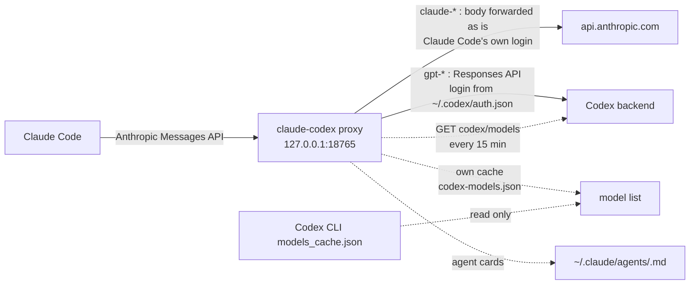

<div align="center">

# claude-codex

*Use any GPT model from Codex as a subagent of Claude Code. The proxy writes the subagent card for every model and keeps it current when OpenAI ships a new one.*

[](https://github.com/josefl03/claude-codex/actions/workflows/ci.yml)
[](LICENSE)
[](https://github.com/josefl03/claude-codex/releases)

</div>

`claude-codex` is a small local proxy between Claude Code and its model backends. Its main use: ask Claude Code to hand a task to `gpt-sol-latest` or `gpt-luna-latest`, and a GPT model from your ChatGPT plan does it while the main session stays on Claude. The proxy creates a subagent card for each Codex model and for each `gpt-*-latest` alias, and keeps the set up to date. When OpenAI publishes a new model, the card appears and the alias moves to it, with no restart of Claude Code for the alias.

It works because the proxy reads the model name of each request: `claude-*` goes to Anthropic with your Claude login, `gpt-*` goes to Codex with your ChatGPT login. You can also run Opus on one plan and Sonnet on the other in the same session.

> A fork of [fcakyon/claude-code-with-codex](https://github.com/fcakyon/claude-code-with-codex), itself a fork of [raine/claude-code-proxy](https://github.com/raine/claude-code-proxy). See [Credits](#credits).

## Disclaimer

This project is not affiliated with, endorsed by, or sponsored by Anthropic or OpenAI. Product and company names belong to their owners and are used only to describe compatibility.

It talks to endpoints that those companies do not document for third-party use, using credentials from official clients you have signed in with. They can change or stop working without notice. You are responsible for checking that your use is allowed by each provider's terms; account restrictions are possible. The software is provided "as is", without warranty (see [LICENSE](LICENSE)).

## What you need

- Claude Code, signed in with a Claude plan (Pro or Max).
- A ChatGPT plan (Plus, Pro or Team) with the Codex CLI installed and signed in (`codex login`).
- Linux or macOS, on x86_64 or arm64 (Windows through WSL 2). No Rust needed: the installer downloads a prebuilt binary.

## Quickstart

One command installs the binary and sets everything up:

```sh
curl -fsSL https://raw.githubusercontent.com/josefl03/claude-codex/main/scripts/install.sh | bash
```

The script needs no sudo and asks nothing. It downloads the prebuilt binary from the latest [GitHub release](https://github.com/josefl03/claude-codex/releases), checks its SHA-256, installs it into `~/.local/bin` and runs `claude-codex enable`: autostart service, systemd linger on Linux (no privileges needed; `disable` and `uninstall` undo it), subagent cards, and Claude Code pointed at the proxy. It ends with a status table and what is left for you. It checks the Codex login but never runs it for you.

Prebuilt binaries ship as one `.tar.gz` plus `.sha256` per platform and a combined `SHA256SUMS`. Windows has no binary: use WSL 2 (the installer stops there with that advice). Cargo is only the fallback when no asset matches and Rust is present:

```sh
cargo install --git https://github.com/josefl03/claude-codex --locked
claude-codex enable
```

### Supported platforms

[](https://github.com/josefl03/claude-codex/actions/workflows/install-smoke.yml)

The [install smoke](docs/releasing.md#install-smoke) workflow runs the real one-liner on GitHub-hosted runners weekly and after each release, with an isolated home and a toy Codex login. Last verified: v0.6.0, 2026-10-22.

| Platform (runner) | Binary | Install and use | Autostart service | Limits |
|---|---|---|---|---|
| Linux x86_64 (`ubuntu-latest`) | `claude-codex-linux-amd64.tar.gz`, static | tested | systemd user unit started and answered `/v1/models` | none seen |
| Linux arm64 (`ubuntu-24.04-arm`) | `claude-codex-linux-arm64.tar.gz`, static | tested | same as x86_64 | none seen |
| macOS Apple silicon (`macos-15`) | `claude-codex-darwin-arm64.tar.gz` | tested, also with only Apple tools and bash 3.2 | launchd agent started and answered `/v1/models` | unsigned binary; the installer ad-hoc signs it |
| macOS Intel (`macos-15-intel`) | `claude-codex-darwin-amd64.tar.gz` | tested, same as Apple silicon | same as Apple silicon | same |
| Windows | none | the installer refuses with a pointer to WSL 2 and changes nothing | none | WSL 2 only, not tested here |

"Tested" covers the checksum, `version`, `status`, `models`, `serve` plus `GET /v1/models`, `agents sync`, `enable`, `disable` and `uninstall` against redirected directories. Runners are headless and never reboot, so starting at boot or at login is not tested.

How releases are published and verified: [docs/releasing.md](docs/releasing.md).

If the summary says the Codex login is missing, sign in once:

```sh
codex login
```

The Codex CLI itself installs with `npm install -g @openai/codex` or `brew install --cask codex`. Restart Claude Code afterwards. `enable --dry-run` previews the changes and `enable --force` replaces a different `ANTHROPIC_BASE_URL`. Variables for the installer (`CLAUDE_CODEX_VERSION`, `CLAUDE_CODEX_INSTALL_DIR`, `CLAUDE_CODEX_NO_SETUP=1`, `CLAUDE_CODEX_REPO`) are listed at the top of [scripts/install.sh](scripts/install.sh).

## Use it

### Subagents on any model

Claude Code's Agent tool offers `sonnet`, `opus`, `haiku` and `fable`. A custom agent with a `model:` line can use any id, so the proxy keeps one card per Codex model in `~/.claude/agents/`, named `<model>.md`, plus one per alias. This is what a card looks like (`~/.claude/agents/gpt-luna-latest.md`, as generated):

```markdown
---
name: gpt-luna-latest
description: "Always the newest luna model of the gpt family, currently gpt-6-luna (provider: codex), through the claude-codex proxy. Delegate a self-contained task to it to get that model's answer."
model: gpt-luna-latest
---
<!-- managed-by: claude-codex; do not edit -->

You are a subagent running on `gpt-luna-latest`, which the claude-codex proxy resolves on every request to the newest luna model of the gpt family (currently `gpt-6-luna`, codex). Complete the task you are given and reply with the result only.
```

Restart Claude Code to load new cards, then ask for a subagent by name:

```text
Use the gpt-sol-latest subagent to review this diff and list anything risky.
Start three gpt-luna-latest subagents in parallel to search the repo, one per top-level directory.
Ask the gpt-sol-latest subagent for a second opinion on this design before you change it.
```

The fan-out prompt, run for real with `claude -p --model haiku` from an empty directory:

```text
Reply in English. Start three gpt-luna-latest subagents in parallel, one per question, each answering in one sentence: (1) what is git bisect for, (2) what is git reflog for, (3) what is git worktree for. Then print the three answers as a numbered list.
```

```text
1. `git bisect` uses binary search across a commit range to find the commit that introduced a bug.
2. `git reflog` records recent movements of Git references, letting you find and recover commits or branch states that may no longer be reachable.
3. `git worktree` lets you check out multiple branches of the same repository in separate directories, so you can work on them independently without switching branches in one directory.
```

Claude Code may log `[claude-code:unrecognized_model]` for the `gpt-*` id; the request still goes through. More runs are in [docs/examples.md](docs/examples.md). The proxy only rewrites or deletes cards with its `managed-by: claude-codex` marker.

### Aliases that follow the newest model

A `-latest` card keeps the same `model:` line forever. The proxy resolves the alias on every request. This is `claude-codex models` on the author's machine:

| Alias | Resolves to |
|---|---|
| `gpt-latest`, `gpt-sol-latest` | `gpt-6.1-sol` |
| `gpt-luna-latest` | `gpt-6-luna` |
| `gpt-terra-latest` | `gpt-5.6-terra` |
| `gpt-astra-latest` | `gpt-6-astra` |
| `gpt-mini-latest` | `gpt-5.4-mini` |
| `gpt-codex-latest`, `gpt-codex-spark-latest` | `gpt-5.3-codex`, `gpt-5.3-codex-spark` |

Versions compare as numbers (`6.1 > 6 > 5.6`), `-fast` copies never count, and variants such as `mini` or `codex` answer only to their own alias. `CCP_LATEST_ALIASES=0` turns the aliases off. Rules in [docs/usage.md](docs/usage.md#latest-aliases).

### Pick a model for the whole session

```text
/model gpt-6-astra[1m]
/model claude-opus-5-5
```

To put a Claude Code slot on Codex, set its variable, for example `ANTHROPIC_DEFAULT_SONNET_MODEL=gpt-5.6-terra`. Do not set `ANTHROPIC_AUTH_TOKEN` or `ANTHROPIC_API_KEY`: they replace your Claude login and the Claude route returns 401.

### Switch it off and on

```sh
claude-codex status      # enabled or not, service, linger, port, settings, cards, Codex login
claude-codex disable     # switch off, keep the install
claude-codex enable      # switch back on
```

`status` on the author's machine (home directory shortened):

```text
claude-codex  0.6.0
state         enabled
service       installed: yes, active: yes, enabled: yes
unit file     ~/.config/systemd/user/claude-codex.service
linger        on (starts at boot; not enabled by setup)
proxy         port 18765, listening: yes, responds: yes
Claude Code   ANTHROPIC_BASE_URL=http://localhost:18765 (this proxy) in ~/.claude/settings.json
agent cards   21 managed in ~/.claude/agents
Codex login   found
```

`disable` stops the service (the unit file stays), removes the managed cards and takes the entries it added out of `settings.json`. If setup turned linger on, `disable` turns it off; a linger you enabled yourself is left alone. The binary, logins and caches stay. Restart Claude Code after `disable` and `enable`. Details: [docs/usage.md](docs/usage.md#enable-disable-and-status).

### Uninstall

`claude-codex uninstall` removes the service, the managed cards, what `setup` added to `settings.json`, and the binary. It asks first (`--yes` in scripts); `--dry-run`, `--keep-binary`, `--purge` and `--purge-credentials` adjust it. It never touches `~/.codex`.

### New models appear on their own

On start, and every 15 minutes after, the proxy asks the Codex backend which models your ChatGPT account can use, with the login the Codex CLI already stored. A new model becomes routable and gets a card; one that disappears loses its card. The list lives in the proxy's own state directory, never in `~/.codex`, and a failed refresh keeps the last good one. Force it with `claude-codex models --refresh`; `CCP_MODEL_DISCOVERY=0` turns it off. Details in [docs/usage.md](docs/usage.md#model-discovery).

## How it works



Claude models are relayed to Anthropic untouched, so prompt caching keeps working, and the proxy holds no Claude credentials. Codex models are translated to the OpenAI Responses API. Reasoning survives a switch: earlier thinking reaches the next model as tagged plain text. More in [ARCHITECTURE.md](ARCHITECTURE.md).

## What this fork adds

| | [raine/claude-code-proxy](https://github.com/raine/claude-code-proxy) | [fcakyon/claude-code-with-codex](https://github.com/fcakyon/claude-code-with-codex) v0.5.1 | claude-codex (this repo) |
|---|---|---|---|
| Claude models via your Claude login (passthrough) | no | yes | yes |
| Codex login | its own | read from the Codex CLI | read from the Codex CLI |
| Autostart service (Linux, macOS) | no | no | yes |
| `enable`, `disable`, `status`, `uninstall` | no | no | yes |
| Subagent cards for every non-Claude model, plus `-latest` aliases | no | no | yes |
| Model list follows the Codex CLI cache while running | no | at startup only | yes |
| Finds new Codex models itself, no Codex CLI run needed | no | no | yes |

Compared on 2026-10-18.

## Configuration

`enable` writes the only required Claude Code setting, `ANTHROPIC_BASE_URL`. The listen port is `PORT` (default `18765`). Every other variable (bind address, config and cards directories, refresh intervals, service settings) is listed in [docs/usage.md](docs/usage.md#environment-variables).

## Security

The listener has no inbound authentication: any process that can reach the port can spend your Claude and ChatGPT sessions. It binds to `127.0.0.1` by default; treat `CCP_BIND_ADDRESS=0.0.0.0` as exposing your accounts. To report a vulnerability, see [SECURITY.md](SECURITY.md).

## When not to use it

- You want an officially supported setup, need a native Windows install (WSL 2 only), or cannot accept that unofficial endpoints may break.

Known limitation: switching plans in the middle of an active tool call can fail, because Anthropic requires a signed `thinking` block.

## Contributing

See [CONTRIBUTING.md](CONTRIBUTING.md), [docs/development.md](docs/development.md) and the [Code of Conduct](CODE_OF_CONDUCT.md). Changes: [CHANGELOG.md](CHANGELOG.md).

## Credits

Built on [raine/claude-code-proxy](https://github.com/raine/claude-code-proxy) (server, Codex translation) and [fcakyon/claude-code-with-codex](https://github.com/fcakyon/claude-code-with-codex) (Claude passthrough, reasoning across switches, Codex CLI login).

## License

[MIT](LICENSE). Copyright (c) 2026 Raine Virta and José Fernández (josefl03).
