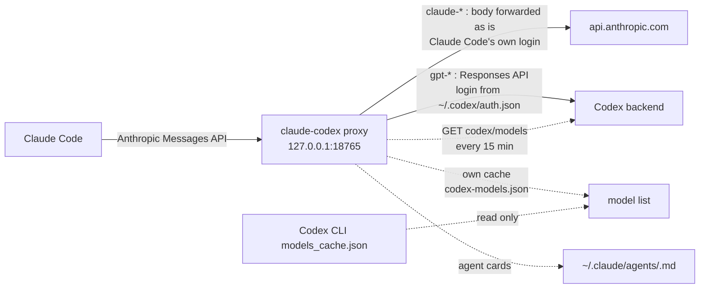

<div align="center">

# claude-codex

*Run Claude Code on your Claude and ChatGPT subscriptions at the same time. New models show up on their own, and any model can be a subagent.*

[](https://github.com/josefl03/claude-codex/actions/workflows/ci.yml)
[](LICENSE)
[](https://github.com/josefl03/claude-codex/releases)

</div>

`claude-codex` is a small local proxy between Claude Code and its model backends. It reads the model name of each request: `claude-*` goes to Anthropic with your Claude login, `gpt-*` goes to Codex with your ChatGPT login. Opus can run on one plan and Sonnet on the other, in the same session.

It finds new Codex models by itself and gives every model a subagent card. Aliases such as `gpt-sol-latest` always point at the newest model of a kind.

> A fork of [fcakyon/claude-code-with-codex](https://github.com/fcakyon/claude-code-with-codex), itself a fork of [raine/claude-code-proxy](https://github.com/raine/claude-code-proxy). See [Credits](#credits).

## Disclaimer

This project is not affiliated with, endorsed by, or sponsored by Anthropic or OpenAI. Product and company names belong to their owners and are used only to describe compatibility.

It talks to endpoints that those companies do not document for third-party use, using credentials from official clients you have signed in with. They can change or stop working without notice. You are responsible for checking that your use is allowed by each provider's terms; account restrictions are possible. The software is provided "as is", without warranty (see [LICENSE](LICENSE)).

## Install

You need Claude Code signed in with a Claude plan, and the Codex CLI signed in with a ChatGPT plan (`codex login`).

```sh
cargo install --git https://github.com/josefl03/claude-codex --locked
claude-codex setup
```

`setup` (the same as `claude-codex enable`) is idempotent. It installs, enables and starts an autostart service (systemd user unit on Linux, LaunchAgent on macOS), creates the subagent cards and adds `ANTHROPIC_BASE_URL` to Claude Code's user `settings.json`. Use `--dry-run` to preview and `--force` to replace a different `ANTHROPIC_BASE_URL`. Then restart Claude Code.

Once the first release exists, an installer script downloads a prebuilt binary and runs `enable` for you:

```sh
curl -fsSL https://raw.githubusercontent.com/josefl03/claude-codex/main/scripts/install.sh | bash
```

Set `CLAUDE_CODEX_REPO=owner/name` for another repository, or `CLAUDE_CODEX_NO_SETUP=1` to skip enabling.

## Use it

Pick a model inside Claude Code:

```text
/model gpt-6-astra[1m]
/model claude-opus-5-5
```

To put a Claude Code slot on Codex, set its variable, for example `ANTHROPIC_DEFAULT_SONNET_MODEL=gpt-5.6-terra`. Do not set `ANTHROPIC_AUTH_TOKEN` or `ANTHROPIC_API_KEY`: they replace your Claude login and the Claude route returns 401.

### Subagents on any model

Claude Code's Agent tool offers `sonnet`, `opus`, `haiku` and `fable`. A custom agent with a `model:` line can use any id, so the proxy keeps one card per non-Claude model in `~/.claude/agents/`, named `<model>.md` (for example `gpt-6-luna`). Restart Claude Code to load new cards, then ask for the subagent by name. The proxy only rewrites or deletes cards that carry its `managed-by: claude-codex` marker.

To get the newest model of a kind without tracking versions, use a `-latest` card. The proxy resolves the alias on every request, so the card never changes and a new model needs no restart of Claude Code:

| Alias | Today |
|---|---|
| `gpt-sol-latest` | `gpt-6.1-sol` |
| `gpt-luna-latest` | `gpt-6-luna` |
| `gpt-terra-latest`, `gpt-astra-latest` | `gpt-5.6-terra`, `gpt-6-astra` |
| `gpt-latest` | the highest version of any `gpt` model |

`claude-codex models` prints the current table. Versions compare as numbers (`6.1 > 6 > 5.6`), `-fast` copies never count, and variants such as `mini` or `codex` answer only to their own alias (`gpt-mini-latest`). `CCP_LATEST_ALIASES=0` turns the aliases off. Rules in [docs/usage.md](docs/usage.md#latest-aliases).

### Switch it off and on

```sh
claude-codex status      # enabled or not, service, port, settings, cards, Codex login
claude-codex disable     # switch off, keep the install
claude-codex enable      # switch back on
```

`disable` stops and disables the service (the unit file stays), removes the managed cards and takes the entries it added out of `settings.json`, so Claude Code never points at a stopped proxy. The binary, logins, caches and setup record stay. Restart Claude Code after `disable` and after `enable`. What each command leaves behind is in [docs/usage.md](docs/usage.md#enable-disable-and-status).

### Uninstall

`claude-codex uninstall` removes the service, the managed cards, what `setup` added to `settings.json`, and the binary. It asks first (`--yes` in scripts); `--dry-run`, `--keep-binary`, `--purge` and `--purge-credentials` adjust it. It never touches `~/.codex`.

### New models appear on their own

On start, and every 15 minutes after, the proxy asks the Codex backend which models your ChatGPT account can use, with the login the Codex CLI already stored. A new model becomes routable and gets a card; one that disappears loses its card. The result lives in the proxy's own state directory, never in `~/.codex`, and a failed refresh keeps the last good list. Force it with `claude-codex models --refresh`; `CCP_MODEL_DISCOVERY=0` turns it off. The `opus`, `sonnet`, `haiku` and `fable` aliases keep fixed preference lists. Details in [docs/usage.md](docs/usage.md#model-discovery).

## How it works



Claude models are relayed to Anthropic untouched, so prompt caching keeps working, and the proxy holds no Claude credentials. Codex models are translated to the OpenAI Responses API; refreshed tokens are written back to the Codex CLI's file so it keeps working. Reasoning survives a switch: earlier thinking reaches the next model as tagged plain text. More in [ARCHITECTURE.md](ARCHITECTURE.md).

## What this fork adds

| | [raine/claude-code-proxy](https://github.com/raine/claude-code-proxy) | [fcakyon/claude-code-with-codex](https://github.com/fcakyon/claude-code-with-codex) v0.5.1 | claude-codex (this repo) |
|---|---|---|---|
| Claude models via your Claude login (passthrough) | no | yes | yes |
| Codex login | its own | read from the Codex CLI | read from the Codex CLI |
| Autostart service (Linux, macOS) | no | no | yes |
| `enable`, `disable`, `status`, `uninstall` | no | no | yes |
| Subagent cards for every non-Claude model, plus `-latest` aliases | no | no | yes |
| Model list follows the Codex CLI cache while running | no | at startup only | yes |
| Finds new Codex models itself, no Codex CLI run needed | no | no | yes |

Compared on 2026-10-18.

## Configuration

`enable` writes the only required Claude Code setting, `ANTHROPIC_BASE_URL`. The listen port is `PORT` (default `18765`). Every other variable (bind address, config and cards directories, refresh intervals, service settings) is listed in [docs/usage.md](docs/usage.md#environment-variables).

## Security

The listener has no inbound authentication: any process that can reach the port can spend your Claude and ChatGPT sessions. It binds to `127.0.0.1` by default; treat `CCP_BIND_ADDRESS=0.0.0.0` as exposing your accounts. To report a vulnerability, see [SECURITY.md](SECURITY.md).

## When not to use it

- You want an officially supported setup, need autostart on Windows, or cannot accept that unofficial endpoints may break.

Known limitation: switching plans in the middle of an active tool call can fail, because Anthropic requires a signed `thinking` block.

## Contributing

See [CONTRIBUTING.md](CONTRIBUTING.md), [docs/development.md](docs/development.md) and the [Code of Conduct](CODE_OF_CONDUCT.md). Changes: [CHANGELOG.md](CHANGELOG.md).

## Credits

Built on [raine/claude-code-proxy](https://github.com/raine/claude-code-proxy) (the server and the Codex translation) and [fcakyon/claude-code-with-codex](https://github.com/fcakyon/claude-code-with-codex) (Claude passthrough, reasoning across switches, Codex CLI login). This fork adds the autostart service, `enable`/`disable`/`setup`, the subagent cards, the `-latest` aliases and the proxy's own model discovery.

## License

[MIT](LICENSE). Copyright (c) 2026 Raine Virta and José Fernández (josefl03).
